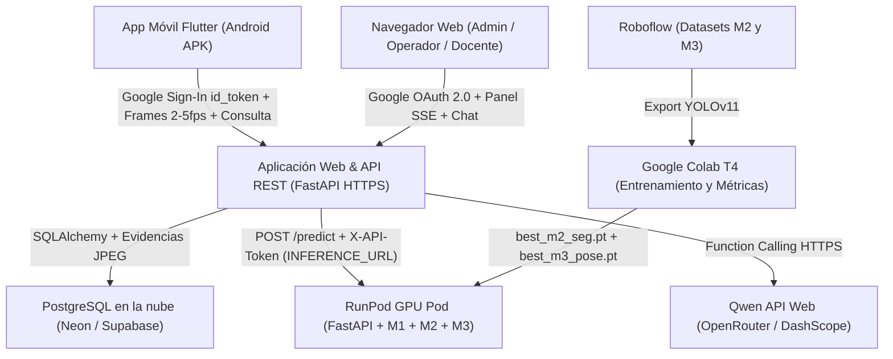

# Sistema Inteligente de Control de Peaje — IAM-811

Sistema de control de peaje de punta a punta basado en visión por computadora en la nube, compuesto por tres modelos de deep learning (**M1 placas + OCR**, **M2 segmentación de instancias** y **M3 keypoints de ruedas para conteo de ejes**), una aplicación web en tiempo real con autenticación exclusiva de Google y un agente conversacional con **Qwen**, más una aplicación móvil **Flutter**.

> **Nota académica:** Todos los servicios de inferencia, base de datos, web, autenticación y entrenamiento corren en la nube (sin recursos locales ni túneles a equipos personales).

---

## 1. Integrante y Roles

| Integrante | Rol | Responsabilidades |
| :--- | :--- | :--- |
| `Cristopher Diego Rodriguez Ayala` (`cristopherrodriguez1510@gmail.com`) | Entrega individual (Full-Stack + Visión + Móvil) | Datasets en Roboflow, entrenamiento en Colab, despliegue RunPod, backend FastAPI + tiempo real + agente Qwen, app Flutter APK y documentación |

---

## 2. Arquitectura del Sistema



---

## 3. Enlaces de Producción y Recursos

| Recurso | Enlace |
| :--- | :--- |
| **Aplicación Web (Subdominio HTTPS)** | `https://[COMPLETAR-SUBDOMINIO]` |
| **Documentación Swagger / OpenAPI** | `https://[COMPLETAR-SUBDOMINIO]/docs` |
| **Endpoint de Inferencia (RunPod)** | `https://[POD_ID]-8000.proxy.runpod.net` |
| **Dataset M2 en Roboflow (Segmentación)** | `https://app.roboflow.com/cristopher-diego-rodriguez-ayala/peaje-vehiculos-seg-6laub` |
| **Dataset M3 en Roboflow (Keypoints ruedas)** | `https://app.roboflow.com/cristopher-diego-rodriguez-ayala/peaje-llantas-keypoints` |
| **Carpeta de Evidencias (Drive/OneDrive)** | `[COMPLETAR-ENLACE-CARPETA]` |

---

## 4. Estructura del Repositorio

```text
/entrenamiento   Notebooks de Google Colab (M1 validación OCR, M2 YOLO-seg, M3 YOLO-pose) + deps
/inferencia      Servidor unificado FastAPI (M1 + M2 + M3), Dockerfile, start_runpod.sh y pesos M1
/web             Aplicación web FastAPI, SSE tiempo real, PostgreSQL/SQLAlchemy, Google OAuth 2.0 y Agente Qwen
/movil           Aplicación móvil Flutter (Google Sign-In, Modo Caseta, Modo Consulta)
/docs            OpenAPI, colección Postman, script de diagnóstico de entornos e informe técnico
.env.example     Plantilla de variables de entorno (sin secretos reales)
render.yaml      Manifiesto de despliegue para Render
```

---

## 5. Tecnologías Utilizadas

- **Visión y Deep Learning:** Ultralytics YOLO11 (`yolo11s-seg`, `yolo11s-pose`), YOLOv9-t ONNX (M1 placas), `fast-plate-ocr` (`cct_xs_v2_global.onnx`), `EasyOCR`, OpenCV, PyTorch CUDA, ONNX Runtime.
- **Inferencia en la Nube:** RunPod GPU Pod + FastAPI + Uvicorn + proxy HTTPS de RunPod.
- **Web, API y Tiempo Real:** Python 3.11, FastAPI, Jinja2 + Tailwind CSS, Server-Sent Events (SSE) + WebSockets, SQLAlchemy + PostgreSQL (Neon/Supabase).
- **Autenticación y Seguridad:** Google OAuth 2.0 (Web) + Google Sign-In (`id_token` verificado en backend) + JWT HS256 + RBAC (`admin` / `operador`) + lista blanca en BD (incluyendo `doc.alvaro.pinto.ma@unifranz.edu.bo` como `admin`).
- **Agente Conversacional:** Qwen API en la nube (OpenRouter / Alibaba DashScope) con *Function Calling* estricto respaldado por consultas SQL y OCR.
- **Aplicación Móvil:** Flutter 3.47 (Dart), `camera`, `google_sign_in`, `image_picker`, `http`, `permission_handler`.

---

## 6. Gestión de Entornos (`conda`, `mamba` y `venv`) y Diagnóstico

Cada servicio incluye sus dependencias con versiones fijadas (`requirements.txt` y `environment.yml`) para recreación exacta:

### A. Entorno de Entrenamiento (`/entrenamiento`)
```bash
conda env create -f entrenamiento/environment.yml
conda activate peaje-entrenamiento
python docs/diagnostico_entorno.py --servicio entrenamiento --out docs/diagnostico_entrenamiento.json
```

### B. Entorno de Inferencia en RunPod (`/inferencia`)
Con `mamba` / `conda`:
```bash
mamba env create -f inferencia/environment.yml
conda activate peaje-inferencia
python docs/diagnostico_entorno.py --servicio runpod_inferencia --out docs/diagnostico_runpod.json
```
O mediante `venv` (como ejecuta automáticamente `inferencia/start_runpod.sh` sobre la imagen CUDA de RunPod):
```bash
cd inferencia
python3 -m venv --system-site-packages .venv
source .venv/bin/activate
pip install -r requirements.txt
python ../docs/diagnostico_entorno.py --servicio runpod_inferencia --out ../docs/diagnostico_runpod.json
```

### C. Entorno Web, API y Agente (`/web`)
Con `venv`:
```bash
cd web
python3 -m venv .venv
source .venv/bin/activate
pip install -r requirements.txt
python ../docs/diagnostico_entorno.py --servicio web_api --out ../docs/diagnostico_web.json
```
O con `conda`/`mamba`:
```bash
mamba env create -f web/environment.yml
conda activate peaje-web
python docs/diagnostico_entorno.py --servicio web_api --out docs/diagnostico_web.json
```

---

## 7. Instrucciones de Despliegue

### 7.1 Entrenamiento (Roboflow + Google Colab)
1. Etiquetar/revisar en Roboflow el dataset de **M2 (Instance Segmentation)** con las 5 clases: `moto`, `auto`, `minibus`, `camion`, `bus`.
2. Etiquetar/revisar en Roboflow el dataset de **M3 (Keypoint Detection)** con los 5 keypoints por rueda: `centro`, `contacto`, `superior`, `izquierda`, `derecha` (partiendo del pre-etiquetado de `entrenamiento/M3_keypoints_ruedas.ipynb`).
3. Ejecutar `entrenamiento/M2_segmentacion_vehiculos.ipynb`, `entrenamiento/M3_keypoints_ruedas.ipynb` y `entrenamiento/M1_validacion_ocr.ipynb` en Google Colab con GPU T4.
4. Descargar `best_m2_seg.pt` y `best_m3_pose.pt` y subirlos a `/workspace/Lab3/inferencia/models/` en el Pod de RunPod.

### 7.2 Inferencia Unificada (RunPod)
1. Crear un GPU Pod en RunPod (ej. RTX A4000 / RTX 3070 / RTX 4090) habilitando el puerto HTTP `8000`.
2. Clonar este repositorio en `/workspace/Lab3` y colocar `best_m2_seg.pt` y `best_m3_pose.pt` en `inferencia/models/`.
3. Exportar `API_TOKEN=<tu-token-seguro>` y ejecutar:
   ```bash
   chmod +x inferencia/start_runpod.sh
   ./inferencia/start_runpod.sh
   ```
4. Verificar `https://<RUNPOD_POD_ID>-8000.proxy.runpod.net/health`.

### 7.3 Aplicación Web + Base de Datos (Neon/Supabase + Render/Railway)
1. Crear base de datos PostgreSQL en Neon o Supabase y copiar su `DATABASE_URL`.
2. Configurar proyecto en Google Cloud Console:
   - OAuth Client ID **Web**: Redirect URI `https://<TU-SUBDOMINIO>/auth/google/callback`.
   - OAuth Client ID **Android**: Package `com.unifranz.peaje_movil` + `SHA-1` del keystore de compilación.
   - Agregar `doc.alvaro.pinto.ma@unifranz.edu.bo` (y tus correos de prueba) a *Test Users* si la pantalla de consentimiento está en modo *Testing*.
3. Desplegar `/web` en Render (usando `render.yaml`) o Railway/Fly.io configurando las variables de `.env.example`.

### 7.4 Aplicación Móvil (Flutter Android APK)
```bash
cd movil
flutter pub get
flutter build apk --release \
  --dart-define=BACKEND_URL=https://[COMPLETAR-SUBDOMINIO] \
  --dart-define=GOOGLE_SERVER_CLIENT_ID=[COMPLETAR-WEB-CLIENT-ID]
```
El APK compilado queda en `movil/build/app/outputs/flutter-apk/app-release.apk`.
